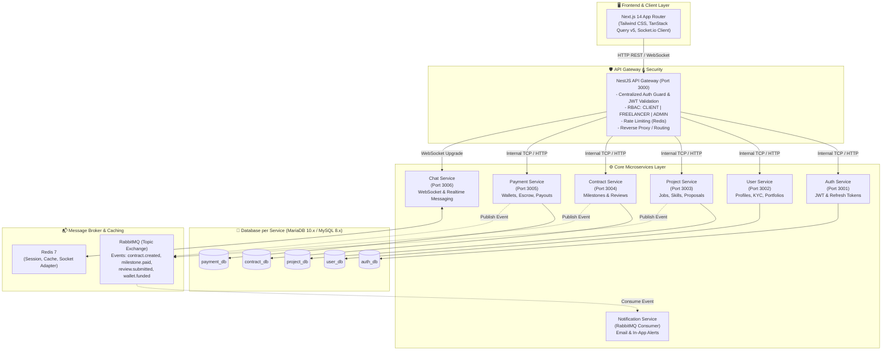
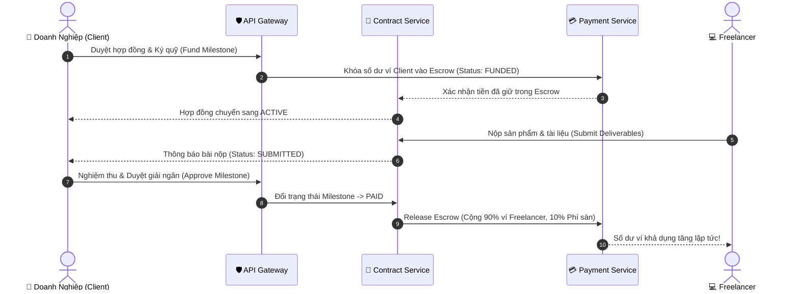
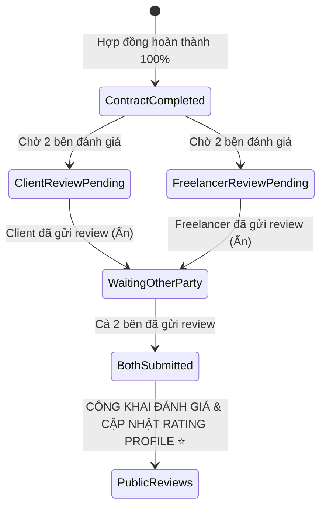

<div align="center">

# 🚀 FreelanceX — Enterprise Microservices Platform

**Nền tảng kết nối Doanh nghiệp & Freelancer xây dựng trên kiến trúc Microservices, Event-Driven và Ký quỹ Escrow an toàn.**

[-black?style=for-the-badge&logo=next.js)](https://nextjs.org/)
[](https://nestjs.com/)
[](https://www.typescriptlang.org/)
[](https://mariadb.org/)
[](https://www.rabbitmq.com/)
[](https://redis.io/)

[Xem Tài Khoản Demo](#-tài-khoản-demo-sẵn-sàng-phỏng-vấn) • [Kiến Trúc Hệ Thống](#-kiến-trúc-hệ-thống-system-architecture) • [Quy Trình Nghiệp Vụ](#-quy-trình-nghiệp-vụ-cốt-lõi-core-workflows) • [Cài Đặt Nhanh](#-hướng-dẫn-cài-đặt--chạy-dự-án)

---

</div>

## 📌 Giới Thiệu Tổng Quan

**FreelanceX** là hệ thống sàn giao dịch việc làm tự do quy mô doanh nghiệp, mô phỏng mô hình hoạt động của Upwork / Fiverr. Dự án giải quyết trọn vẹn bài toán từ **Đăng tuyển việc làm**, **Nộp hồ sơ chào thầu (Proposals)**, **Hợp đồng & Nghiệm thu theo giai đoạn (Milestones)**, **Cơ chế thanh toán ký quỹ giữ tiền an toàn (Escrow Payment)**, đến **Đánh giá nhận xét 2 chiều (Blind Reviews)** và **Quản trị tài chính Admin**.

---

## 🏛️ Kiến Trúc Hệ Thống (System Architecture)

Hệ thống được thiết kế theo chuẩn **Microservices Architecture**, áp dụng nguyên tắc **Database-per-Service** (mỗi microservice sở hữu một database logic độc lập, không join bảng chéo) và **Event-Driven Architecture** qua RabbitMQ để tối ưu hóa hiệu năng, tính module hóa và khả năng mở rộng (Scalability).



---

## ⚡ Điểm Sáng Kỹ Thuật (Key Technical Highlights)

### 1. 🛡️ Cơ Chế Ký Quỹ Escrow & An Toàn Giao Dịch
* **ACID Transactions**: Toàn bộ thao tác khóa tiền (Escrow Hold), giải ngân (Release) và hoàn tiền (Refund) đều được thực thi trong Database Transaction cấp độ nghiêm ngặt, chống race conditions và double-spending.
* **Idempotency Key**: Đảm bảo các yêu cầu nạp tiền, giải ngân hay rút tiền nếu người dùng bấm đúp hoặc mạng chập chờn sẽ không bị trùng lặp giao dịch.
* **Tự động khấu trừ Phí sàn (Platform Fee)**: Tự động trích xuất 10% phí dịch vụ vào tài khoản doanh thu hệ thống khi giải ngân cho Freelancer.



---

### 2. ⭐ Cơ Chế Đánh Giá Nhận Xét 2 Chiều (Blind Review Pattern)
* **Chống trả đũa (Anti-Retaliation)**: Cả Doanh nghiệp và Freelancer đều thực hiện đánh giá độc lập (1 - 5 sao và nhận xét văn bản).
* **Quy tắc công bố đồng thời**: Đánh giá được lưu trữ ở trạng thái ẩn cho đến khi **cả hai bên đều đã hoàn tất đánh giá** (hoặc sau thời hạn 14 ngày). Khi đó hệ thống mới mở công khai và tính điểm trung bình vào hồ sơ uy tín.



---

### 3. 🌐 Frontend Kiến Trúc Hiện Đại
* **Next.js 14 (App Router)** với Server & Client Components tối ưu SEO và tốc độ tải trang.
* **TanStack Query (React Query) v5**: Toàn bộ query keys được quản trị tập trung tại `frontend/src/lib/query-keys.ts`, loại bỏ xung đột cache và tối ưu hóa việc invalidate dữ liệu sau mỗi mutation.
* **Responsive & UI cao cấp**: Thiết kế phong cách Dark/Light hiện đại, micro-animations, loại bỏ triệt để thanh cuộn lỗi, giao diện chuẩn SaaS.

---

## 🔑 Tài Khoản Demo Sẵn Sàng Phỏng Vấn

Dự án đã tích hợp sẵn tập dữ liệu mẫu toàn diện phục vụ demo trực tiếp:

| Role | Tài khoản (Email) | Mật khẩu | Số dư ví | Mục đích Demo |
| :--- | :--- | :--- | :--- | :--- |
| 👑 **Super Admin** | `admin@freelancex.com` | `admin123` | — | Xem thống kê tài chính, biểu đồ doanh thu, duyệt lệnh rút tiền tại `/admin`. |
| 🏢 **VIP Client** | `client@freelancex.com` | `password123` | **50.000.000 ₫** | Đăng dự án, nghiệm thu sản phẩm, giải ngân Escrow tức thì. |
| 💻 **Top Freelancer** | `freelancer@freelancex.com` | `password123` | **24.500.000 ₫** | ⭐ **5.0/5.0**, KYC Verified, nộp bài, xem review 2 chiều. |

### 🎯 Các Đường Dẫn Kịch Bản Test Nhanh (Direct Demo URLs):
1. **Hợp đồng COMPLETED (Có Review 2 chiều công khai):**  
   👉 `/contracts/cccccccc-1111-1111-1111-111111111111`
   - Hiển thị 3 mốc hoàn thành, sản phẩm nộp, và 2 thẻ đánh giá 5 sao từ Client & Freelancer.
2. **Hợp đồng ACTIVE (Chờ duyệt nghiệm thu hoặc yêu cầu sửa đổi):**  
   👉 `/contracts/cccccccc-2222-2222-2222-222222222222`
   - Đăng nhập tài khoản `client@freelancex.com` để thử bấm **Duyệt & Giải ngân (Approve & Release)** hoặc **Yêu cầu chỉnh sửa (Request Revision)**.
3. **Trang Quản trị Hệ thống & Tài chính:**  
   👉 `/admin` (Đăng nhập tài khoản `admin@freelancex.com`).
4. **Ví điện tử & Lịch sử giao dịch:**  
   👉 `/wallet` (Hiển thị số dư khả dụng, tiền đang ký quỹ Escrow và sao kê biến động số dư).

---

## 📂 Cấu Trúc Thư Mục Monorepo

```bash
freelance-platform/
├── backend/                             # NestJS Monorepo
│   ├── apps/
│   │   ├── api-gateway/                 # Cổng tiếp nhận API duy nhất (Port 3000)
│   │   ├── auth-service/                # Quản lý tài khoản, JWT, Refresh Token (Port 3001)
│   │   ├── user-service/                # Hồ sơ cá nhân, Freelancer Profile, KYC (Port 3002)
│   │   ├── project-service/             # Dự án, Kỹ năng, Báo giá Proposals (Port 3003)
│   │   ├── contract-service/            # Hợp đồng, Milestones, Submissions, Reviews (Port 3004)
│   │   ├── payment-service/             # Ví tiền, Giao dịch Ký quỹ Escrow, Payouts (Port 3005)
│   │   ├── chat-service/                # WebSocket chat real-time (Port 3006)
│   │   └── notification-service/        # RabbitMQ worker gửi thông báo nền
│   ├── libs/                            # Thư viện dùng chung (DTOs, Contracts, Utils)
│   └── seed-master.ts                   # Kịch bản nạp dữ liệu mẫu 5 DBs tự động
│
├── frontend/                            # Next.js 14 App Router
│   ├── src/
│   │   ├── app/                         # App Router Pages ((auth), (dashboard), admin, ...)
│   │   ├── components/                  # UI Components (Projects, Contracts, Wallet, Reviews)
│   │   ├── hooks/api/                   # Custom React Query hooks (chuẩn hóa queryKeys)
│   │   └── lib/query-keys.ts            # Centralized Query Key Factory
│
├── docker-compose.yml                   # Hạ tầng hạ tầng Redis & RabbitMQ
├── start-all.bat                        # Script 1-click khởi chạy toàn bộ 8 Microservices
└── README.md
```

---

## 🚀 Hướng Dẫn Cài Đặt & Chạy Dự Án

### Yêu Cầu Hệ Thống:
* **Node.js**: >= 18.x
* **Docker & Docker Compose** (Chạy MariaDB, Redis & RabbitMQ)

---

### ⚡ Cách 1: Khởi động 1-Click (Khuyên dùng khi phát triển / Demo phỏng vấn)

Chỉ với **2 bước**:

1. **Nạp dữ liệu mẫu (Chỉ cần chạy lần đầu tiên):**
   ```bash
   cd backend && npm install && npx tsx seed-master.ts
   ```
2. **Khởi động toàn bộ nền tảng (1-Click Run):**
   * **Trên Windows:** Chỉ cần click đúp vào file [`start-all.bat`](file:///d:/freelance-platform/start-all.bat) ở thư mục gốc!  
     *(Script sẽ tự động: Kích hoạt Docker infrastructure MariaDB/Redis/RabbitMQ ➔ Bật 8 Microservices ➔ Bật Next.js Frontend).*
   * Mở trình duyệt tại: **`http://localhost:3002`**

---

### 🐳 Cách 2: Chạy độc lập từng phần

1. **Khởi động hạ tầng (Database, Message Broker, Cache):**
   ```bash
   docker compose up -d
   ```
   > - MariaDB: `localhost:3306` (Tự động khởi tạo 7 database độc lập)
   > - RabbitMQ Management Web UI: `http://localhost:15672` (User/Pass: `guest` / `guest`)
   > - Redis: `localhost:6379`

2. **Chạy Backend & Frontend:**
   ```bash
   # Terminal 1: Chạy API Gateway
   cd backend && npm run start:dev api-gateway

   # Terminal 2: Chạy Frontend Next.js
   cd frontend && npm run dev
   ```
   - Frontend UI: `http://localhost:3002`
   - API Gateway: `http://localhost:3000`

---


## 🏆 Kịch Bản Trình Bày Phỏng Vấn (Live Demo 5 Phút Ghi Điểm)

1. **Phần 1 - Kiến trúc & Công nghệ (1 phút):**
   - Giới thiệu mô hình **Microservices** với API Gateway độc lập.
   - Giải thích nguyên lý **Database-per-Service** và lý do dùng **RabbitMQ** thay vì HTTP sync để chống nghẽn và tăng resilience.
2. **Phần 2 - Tính năng Khách hàng & Ký quỹ (2 phút):**
   - Login `client@freelancex.com` -> Vào hợp đồng `/contracts/cccccccc-2222-2222-2222-222222222222`.
   - Xem bài nộp của Freelancer -> Click **"Duyệt & Giải ngân"**.
   - Chỉ ra tiền ký quỹ Escrow tự động chuyển sang ví Freelancer sau khi trừ 10% phí sàn hệ thống.
3. **Phần 3 - Đánh giá 2 chiều & Bảng điều khiển Quản trị (2 phút):**
   - Cho xem hợp đồng hoàn thành `/contracts/cccccccc-1111-1111-111111111111` có đầy đủ 2-way reviews.
   - Đăng nhập `admin@freelancex.com` -> Show trang **Admin Dashboard**: Biểu đồ doanh thu phí sàn, danh sách rút tiền chờ duyệt.

---

## 📄 Bản Quyền & Giấy Phép
Dự án được phát triển dưới giấy phép **MIT License**.
